<h2>Howdy! I'm Aarif 👋</h2>

I build software for real operations, with a background in physics from Texas A&M (B.S. Physics, minor in Mathematics). I like making custom solutions that fit the flow of a business rather than forcing the business to adapt to the software.

On the research side, I work on quantum statistics and the fermion sign problem with Dr. Siu A. Chin. I enjoy problems where the math and the code both matter, and I'm also drawn to electronics, robotics and quantitative finance.

<h3>🏭 What I Build</h3>

- **Manufacturing operations management system.** An in-house platform that brings each department's machine, ERP and quality records into one place.
- **Logistics operations management system.** One live schedule for a truck fleet, from request and approval to GPS tracking and delivery.
- **AI contract review.** An LLM pipeline that reads long construction contracts and links every flagged clause back to its exact spot in the PDF.

<h3>📄 Research</h3>

| Paper | Status |
|-------|--------|
| [The Path Integral Monte Carlo Sign Problem Is Not Always NP-Hard: Harmonic Fermions Can Be Solved in Quadratic Time](https://arxiv.org/abs/2609.09071) | In revision at *Physical Review E* |
| [Parafermions in Plain Sight](https://arxiv.org/abs/2609.00545) | Under review at *Physical Review E* |
| [Newton's Identity in Finite-Bead Fermionic Partition Function](https://arxiv.org/abs/2606.05442) | Under review at *J. Stat. Mech.* |
| [The Arithmetic of Spectra: Factorization, Statistics, and Symmetric Functions](https://arxiv.org/abs/2609.10391) | Preprint |

<h3>🧰 Projects</h3>

- **Keel.** A framework that keeps AI coding agents on course while they build and repair production apps.
- **Accounts Payable Three-Way Match.** Matches purchase orders, invoices and receipts by extracting every field with its location and linking documents in a graph database.
- **SEC Filings Pipeline and Backtesting Engine.** Pulls company filings from SEC EDGAR, extracts key metrics with an LLM, and replays market data to test trading strategies.
- **Machine Learning for Physics.** Physics-informed graph neural networks and neural importance sampling for Monte Carlo.

<h3>🛠 Tech Stack</h3>

  

Also Julia, Mathematica, Gemini, Claude Code, LangChain, LlamaIndex, Docling and Odoo.

<h3>📂 Selected Repositories</h3>

| Repository | Description |
|------------|-------------|
| [Hamiltonian Graph Networks](https://github.com/AarifCha/Hamiltonian-Graph-Networks) | Physics-informed graph neural networks for systems with a variable number of particles (TF-GNN) |
| [Statistical Network](https://github.com/AarifCha/Statistical-Network) | Neural networks that learn sampling distributions to speed up Monte Carlo integration |
| [Scientific RAG Gemini](https://github.com/AarifCha/Scientific-RAG-Gemini) | A Gemini research assistant for question answering over scientific papers |
| [RAG-HF-Langchain](https://github.com/AarifCha/RAG-HF-Langchain) | Retrieval over PDFs with a Hugging Face model and LangChain, runnable in Google Colab |
| [StringComp](https://github.com/AarifCha/StringComp) | String theory computational project (on hold) |

<h3>🐍 Contributions</h3>

<picture>
  <source media="(prefers-color-scheme: dark)" srcset="https://raw.githubusercontent.com/AarifCha/AarifCha/output/github-snake-dark.svg"/>
  <source media="(prefers-color-scheme: light)" srcset="https://raw.githubusercontent.com/AarifCha/AarifCha/output/github-snake.svg"/>
  
</picture>

<h3>🤝🏻 Connect with Me</h3>

  

